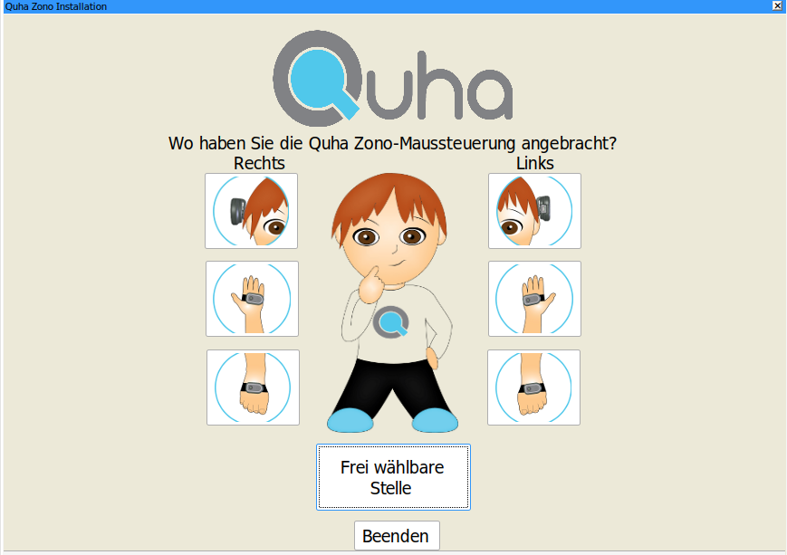
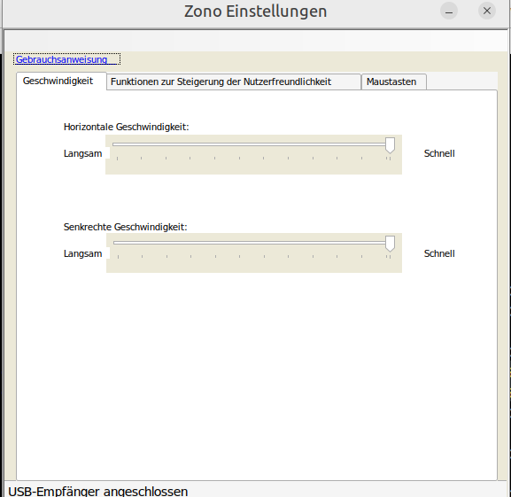
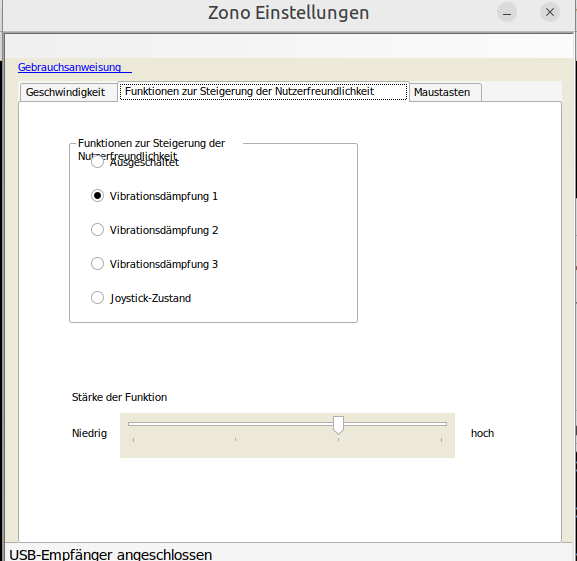

# Quha Zono unter Linux (Wine) einrichten

Anleitung zur Installation und Inbetriebnahme der Quha-Zono-Windows-Software
unter Linux via Wine, inkl. Fix für den USB/HID-Zugriff.

## Voraussetzungen

- Wine (getestet mit Standard-Distro-Paket sowie WineHQ-Repo)
- Wine Mono (für die .NET-basierte Settings-App)
- Quha USB-Empfänger: `04d8:f8c4` (Microchip Technology, Inc. Quha USB Receiver)

## 1. Wine installieren

```bash
sudo dpkg --add-architecture i386
sudo apt update
sudo apt install wine wine32 wine64
```

`wine-gecko` und `wine-mono` müssen nicht zwingend über apt installiert werden
(oft nicht in den Repos vorhanden) — Wine lädt sie bei Bedarf selbst nach,
oder man installiert Mono manuell (siehe unten).

Für eine aktuellere Wine-Version ggf. das offizielle WineHQ-Repo einbinden:

```bash
sudo mkdir -pm755 /etc/apt/keyrings
sudo wget -O /etc/apt/keyrings/winehq-archive.key https://dl.winehq.org/wine-builds/winehq.key
sudo wget -NP /etc/apt/sources.list.d/ https://dl.winehq.org/wine-builds/ubuntu/dists/$(lsb_release -cs)/winehq-$(lsb_release -cs).sources
sudo apt update
sudo apt install --install-recommends winehq-stable
```

## 2. Installer entpacken und ausführen

```bash
cd ~/Downloads
unzip Quha_Zono_Setup_v1.51.exe.zip -d quha_zono
cd quha_zono
wine Quha_Zono_Setup_v1.51.exe
```

Installiert nach `~/.wine/drive_c/Program Files (x86)/Quha/Zono/`.

## 3. Wine Mono nachinstallieren (falls "Wine Mono is not installed")

Die Settings-App ist eine .NET-Anwendung und braucht Wine Mono:

```bash
cd /tmp
wget https://dl.winehq.org/wine/wine-mono/9.3.0/wine-mono-9.3.0-x86.msi
wine msiexec /i wine-mono-9.3.0-x86.msi
```

(Aktuelle Version ggf. unter https://dl.winehq.org/wine/wine-mono/ prüfen.)

## 4. USB/HID-Zugriff freigeben (der eigentliche Knackpunkt)

Die Software zeigt zunächst **"USB-Empfänger Status unbekannt"**, obwohl
`lsusb` das Gerät korrekt anzeigt und `/dev/bus/usb/...` bereits beschreibbar
ist. Ursache: Quha kommuniziert über den **hidraw**-Kernel-Layer, und die
zugehörigen `/dev/hidraw*`-Devices sind standardmäßig root-only.

Der Zono-Empfänger meldet zwei HID-Interfaces (im Beispiel `hidraw0` und
`hidraw1` für Vendor `04d8` / Product `f8c4`) — identifizieren mit:

```bash
for dev in /dev/hidraw*; do
  echo "$dev:"
  udevadm info -a -n $dev | grep -m1 -E "idVendor|idProduct"
done
```

Udev-Regel anlegen:

```bash
sudo nano /etc/udev/rules.d/99-quha.rules
```

Inhalt:

```
SUBSYSTEM=="usb", ATTR{idVendor}=="04d8", ATTR{idProduct}=="f8c4", MODE="0666"
KERNEL=="hidraw*", ATTRS{idVendor}=="04d8", ATTRS{idProduct}=="f8c4", MODE="0666"
```

Anwenden und Empfänger neu einstecken (wichtig — die Regel greift nur bei
einem neuen "add"-Event):

```bash
sudo udevadm control --reload-rules
sudo udevadm trigger
```

Prüfen:

```bash
ls -la /dev/hidraw0 /dev/hidraw1
# erwartet: crw-rw-rw-
```

## 5. Programme starten

Initialisierung/Kalibrierung:

```bash
cd "/home/uwe/.wine/drive_c/Program Files (x86)/Quha/Zono/Initialization"
wine Qcal.exe
```

Einstellungen:

```bash
wine "C:\Program Files (x86)\Quha\Zono\Settings\Quha Zono Settings.exe"
```

Bei erfolgreichem Zugriff zeigt die Statuszeile **"USB-Empfänger
angeschlossen"** statt "Status unbekannt".

## Screenshots

Kalibrierungsassistent (Auswahl der Anbringungsstelle):



Einstellungen — Geschwindigkeit:



Einstellungen — Funktionen zur Steigerung der Nutzerfreundlichkeit:



## Ergebnis

Nach Setzen der udev-Regel für `hidraw0`/`hidraw1` erkennt sowohl `Qcal.exe`
als auch die Settings-App den Empfänger zuverlässig, und die Kalibrierung
(Anbringungsort: Kopf/Hand/Handgelenk links/rechts oder frei wählbar) läuft
durch.
